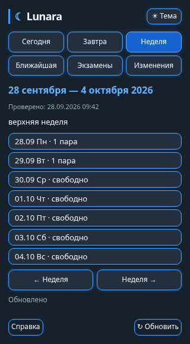
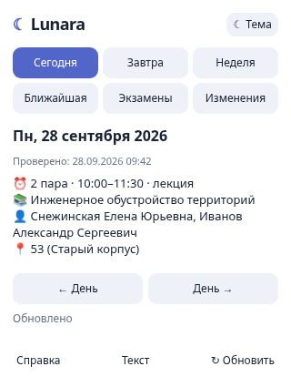

# Виджеты расписания в личном чате

Исследование выполнено 9 ноября 2026, Bot API 10.4. Основание:
[руководство Widgets](https://core.telegram.org/bots/widgets),
[sendWidget](https://core.telegram.org/bots/api#sendwidget),
[WidgetQuery](https://core.telegram.org/bots/api#widgetquery),
[answerWidgetQuery](https://core.telegram.org/bots/api#answerwidgetquery).

## Что реализовано

Только `/widget` в личке открывает виджет с расписанием на сегодня.
`/today`, `/tomorrow`, `/week`, `/nextweek`, `/day ДД.ММ.ГГГГ`, `/next`, `/exams`,
`/changes`, `/start` и `/help` отвечают обычными текстовыми сообщениями.
Уведомления об изменениях и рассылки также остаются текстовыми.
Каждый `/widget` создаёт новое сообщение; кнопки навигации не создают сообщений.
Кнопка «Текст» явно запрашивает обычное текстовое расписание текущего дня
или ближайшую пару.

Меню: сегодня, завтра, неделя, ближайшая пара, экзамены, изменения, справка.
Неделя показывает семь дней и количество занятий; нажатие открывает день.
Стрелки переключают дни/недели, «Ранее» — историю изменений. Для произвольной
даты есть `/day`: виджеты Telegram не поддерживают поля ввода и клавиатуру.
В дневном расписании одна страница соответствует одной паре, без разбиения
текста на обрывки. Если целая карточка не помещается в ответ 1024 байта или в
высоту 600 px, показывается краткий текст с явной подсказкой нажать «Текст».
Кнопка отправляет полное расписание обычными сообщениями. История и справка
по-прежнему допускают текстовую пагинацию.
Ссылки карты сохраняются текстом, кликабельная версия доступна по кнопке «Текст» или через `/day ДД.ММ.ГГГГ`.

По умолчанию используется собственная тёмная палитра независимо от темы Telegram.
Кнопка «Тема» в заголовке переключает светлую и тёмную палитры. Выбор сохраняется
в localStorage этого сообщения на устройстве; при недоступном хранилище тема
переключается до пересоздания виджета. Старые сообщения сохраняют прежний HTML,
поэтому после обновления бота нужно отправить новую команду `/widget`. Все данные поступают из существующего кеша,
проверки сайта по нажатию нет. «Проверено» — время проверки источника,
«Обновлено» — успешное чтение из кеша. При повторном открытии виджет запрашивает
сохранённый раздел; кнопка «Обновить» перечитывает его вручную. Периодического
фонового опроса нет. Дата открытого дня фиксирована, «Сегодня» вычисляется
заново при нажатии по часовому поясу бота.

`/text week`, `/text today`, `/text exams` и аналогичные команды возвращают
обычный текст, как и команды без `/text`. Подпись виджета подсказывает `/today`
для старых клиентов.
Если сервер отвергает `sendWidget` с 400/404, бот отвечает текстом. При
неоднозначной сетевой ошибке или 429 дополнительный текст не отправляется.

## Личные сообщения и группы

В production Telegram пока разрешает виджеты только в личке; группы, inline и
пересылка доступны на тестовом сервере. Эта реализация намеренно работает
только в личных чатах. В группах остаётся прежнее текстовое поведение и фильтр
чата/топика. У каждого личного сообщения свой виджет, поэтому пользователи
не переключают экраны друг другу. Учебная группа по-прежнему одна, из GROUP_ID;
выбора разных учебных групп в этом изменении нет.

На будущее: `chat_data` группового сообщения общие для участников. Независимое
управление можно строить на локальном состоянии клиента и адресных ответах
`answerWidgetQuery`, но общие данные нельзя считать приватными. Для текущего
личного интерфейса достаточно адресных ответов, без shared widget.

## Протокол и ограничения

- HTML встроен в Go binary через `go:embed`, внешний хостинг не нужен.
- HTML проверяется на 32768 байт и 4096 байт zlib BestCompression.
- Начальная страница — JSON-строка в `chat_data`; `public_data` не используется.
- Запрос: `w1|режим|ISO-дата/курсор|страница`, максимум 64 UTF-8 байта.
- Ответ: JSON-строка, максимум 1024 UTF-8 байта. Краткие ключи документированы
  в `widgetPage`; `p/n` — страницы текста, `e/a` — даты/история, `r` — дни недели.
- Ответ приходит только запросившему экземпляру. Он не меняет серверные данные
  сообщения. В localStorage сохраняются последний запрос и тема, а не расписание.
- Запросы принимаются только с `type=data`, положительным `message_id` и
  совпадающими `from.id` / `chat.id` в приватном чате. Inline и группы отклоняются.
- Чтение ограничено 8 секундами, отправка ответа — 4 секундами при лимите Telegram
  15 секунд. Просроченный ответ не останавливает polling и не повторяет update.
- Данные источника вставляются через `textContent`, не как исполняемый HTML.
- Схема БД, уведомления и watcher не меняются.

## Проверка

`go test -race ./...`, `go vet ./...`, `go build ./...`.
Тесты проверяют контракт API, маршрутизацию команд, приватность, ограничения
UTF-8, пагинацию длинных данных, неподдерживаемые запросы и fallback.
Браузерная проверка: 200/320/430 px, светлая/тёмная тема, переключение разделов,
длинный текст без обрезки, восстановление раздела после перезагрузки,
ошибка TIMEOUT и повторное обновление. Это проверка HTML и mock TelegramWidget;
она не заменяет проверку в настоящем Telegram QuickJS renderer.

Перед слиянием желательно открыть `/week`, день с несколькими парами,
`/changes`, `/exams`, `/text week` в актуальном Telegram на телефоне и Desktop.
Проверить восстановление при повторном открытии и оба оформления.
Живые запросы к боту и production-развёртывание при разработке не выполнялись.

### Повторение браузерной проверки

Playwright нужен только для проверки, не для сборки и работы бота.
Установите его отдельно (например, `npm install --prefix /tmp/lunara-ui playwright`),
затем выполните из корня репозитория:

```sh
LUNARA_WIDGET_FIXTURE=/tmp/lunara-widget-preview.json go test ./internal/telegram -run TestWidgetUIFixture
PLAYWRIGHT_MODULE=/tmp/lunara-ui/node_modules/playwright CHROMIUM_PATH=/usr/bin/google-chrome-stable node scripts/test-widget-ui.cjs
```

Если используется браузер, установленный Playwright, `CHROMIUM_PATH` можно не
задавать. PNG сохраняются в `/tmp/lunara-widget-{week,day}-{200,320,430}-{light,dark}.png`.
Тест использует локальную перехваченную страницу, к Telegram не подключается.

### Превью

Демонстрационные данные, браузерная имитация TelegramWidget (не скриншоты Telegram).



